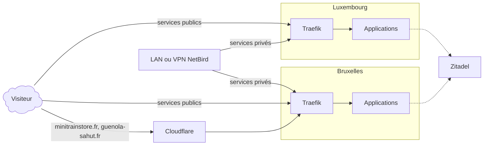

# 🏗️ Architecture

Cette page décrit comment les serveurs se répartissent les services, comment une requête atteint un service et comment les utilisateurs s’authentifient. Le matériel est détaillé dans l’[inventaire](inventaire.md), l’adressage dans la page [Réseau](reseau.md).

## 🖥️ Hôtes et rôles {#hotes}

| Hôte                                   | Nature                                           | Rôle                                                                                                                                                         |
| -------------------------------------- | ------------------------------------------------ | ------------------------------------------------------------------------------------------------------------------------------------------------------------ |
| [Luxembourg](inventaire.md#luxembourg) | Machine virtuelle Oracle Cloud, adresse publique | Services qui doivent rester joignables même si le site principal est coupé : VPN NetBird, page d’état, supervision, traduction (Tolgee), protection CrowdSec |
| [Bruxelles](inventaire.md#bruxelles)   | Serveur TrueNAS du site principal                | La majorité des services : données, médias, domotique, identité (Zitadel), messagerie Matrix, outils internes                                                |
| [Pristina](inventaire.md#pristina)     | Machine virtuelle Debian                         | Cible de sauvegarde : reçoit une réplication ZFS de Bruxelles                                                                                                |
| [Paris](inventaire.md#paris)           | Ordinateur de bureau                             | Poste de travail, et seconde cible de réplication de Bruxelles                                                                                               |

Sur Bruxelles, les services viennent de deux sources : les applications du catalogue TrueNAS (TrueNAS Apps), installées depuis son interface, et les piles Docker Compose déployées par Ansible depuis le [dépôt Infrastructure](https://github.com/AlixANNERAUD/Infrastructure). Sur Luxembourg, tout est déployé par Ansible. Le [déploiement](deploiement.md) détaille ce fonctionnement.

Ce site et le portfolio sont hébergés à part, sur GitHub Pages.

## 🛣️ Parcours d’une requête {#parcours-requete}

Chaque hôte a son propre [Traefik](https://traefik.io/traefik/), seul conteneur à publier les ports web (80 et 443). Traefik termine le TLS, applique les protections communes, puis transmet la requête au conteneur du service par un réseau Docker.

- **Services publics :** leur nom DNS pointe vers l’adresse publique de l’hôte (voir [DNS](dns.md)). Bruxelles est joint par la connexion fibre du site principal, Luxembourg directement.
- **Sites derrière Cloudflare :** `minitrainstore.fr` et `guenola-sahut.fr` passent par le proxy de Cloudflare, qui sert de cache et de filtre. Traefik refuse pour ces sites toute connexion qui ne vient pas de Cloudflare, et retrouve l’adresse réelle du visiteur dans les en-têtes transmis.
- **Services privés :** leur nom DNS pointe vers une adresse du réseau local, et leur route Traefik n’accepte que le LAN et le VPN (voir [Sécurité](securite.md#services-internes)). Depuis l’extérieur, on y accède par le VPN.
- **Tâches internes :** certains services sont joints sans passer par Internet, par exemple la supervision qui interroge Traefik sur un point d’entrée réservé au réseau Docker (voir [Supervision](supervision.md)).

### 🔐 VPN NetBird {#vpn}

[NetBird](https://netbird.io/) relie les appareils et les serveurs dans un réseau maillé chiffré (WireGuard). Son serveur de gestion, de signalisation et de relais tourne sur Luxembourg, joignable publiquement pour que les appareils puissent s’y connecter ; il a son propre fournisseur d’identité intégré. Une fois connecté, un appareil atteint les services privés des deux hôtes comme s’il était sur le LAN. Les serveurs l’utilisent aussi entre eux, par exemple pour la supervision de Bruxelles depuis Luxembourg. La plage d’adresses du VPN est donnée dans la page [Réseau](reseau.md#vpn-mesh-netbird).

### 💬 Fédération Matrix {#matrix}

Le serveur Matrix (Synapse) de `anneraud.fr` tourne sur Bruxelles. Les identifiants sont de la forme `@nom:anneraud.fr` : le domaine nu `anneraud.fr` publie la délégation Matrix (`/.well-known/matrix`) et transmet les requêtes de fédération à Synapse, sur le port 443 ; le reste du domaine nu redirige vers `www.anneraud.fr`. L’API d’administration de Synapse n’est accessible que depuis le LAN ou le VPN.

Luxembourg héberge aussi quelques services pour le domaine distinct `dera.page`.

## 🪪 Authentification unique {#authentification}

[Zitadel](https://zitadel.com/), à l’adresse [authentification.anneraud.fr](https://authentification.anneraud.fr/), est le fournisseur d’identité de l’infrastructure. Les services s’y raccordent en OpenID Connect (OIDC) : l’utilisateur se connecte une fois sur Zitadel, puis accède aux services qui lui sont ouverts.

Les applications OIDC ne sont pas créées à la main : elles sont décrites dans <RepositoryReference path="opentofu/zitadel/applications.auto.tfvars" /> et créées par [OpenTofu](https://opentofu.org/) avec le fournisseur officiel de Zitadel.

- Chaque application déclare ses adresses de retour, ses rôles et son mode d’authentification : PKCE par défaut, secret client seulement quand le service l’exige.
- Un service déployé par Ansible provisionne son application au moment de son déploiement (rôle `zitadel_applications`), puis reçoit l’identifiant client dans sa configuration. Pour les services gérés hors d’Ansible, un playbook dédié crée les applications et indique où reporter le résultat.
- Les rôles du projet décident des droits dans le service. Par exemple, la supervision (Grafana) donne le rôle d’administrateur aux membres du rôle `vigie-admin` et un accès en lecture aux autres.
- L’état d’OpenTofu est chiffré (chiffrement natif d’OpenTofu) et conservé avec les autres secrets, hors du dépôt public.

La supervision est la première application raccordée de cette façon ; l’outil de déploiement Semaphore doit suivre (voir la [feuille de route](feuille-de-route.md)).

## 📇 DNS {#dns}

Les zones DNS sont hébergées chez Cloudflare et décrites dans le dépôt. Chaque service crée ses propres enregistrements au déploiement, publics ou privés selon son accès. Voir la page [DNS](dns.md).
