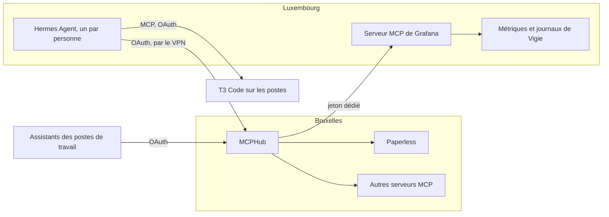

# 🤖 Assistants IA

Les assistants IA (Claude Code, Codex, OpenCode, Antigravity…) accèdent aux outils de l’infrastructure par le protocole [MCP](https://modelcontextprotocol.io/), tous par le même point d’entrée : [MCPHub](https://github.com/samanhappy/mcphub). Quel que soit le fournisseur du modèle, il atteint les mêmes serveurs MCP, avec les mêmes droits.



## 🧭 MCPHub {#mcphub}

MCPHub (<RepositoryReference path="services/mcphub" />) tourne sur Bruxelles, à l’adresse `mcphub.anneraud.fr`, accessible uniquement depuis le réseau local ou le VPN. Il conserve ses serveurs et ses utilisateurs dans sa propre base PostgreSQL, sauvegardée par l’outil de sauvegarde des bases.

- **Connexion :** par [Zitadel](authentification.md) ; le compte `admin` local reste en secours. Une première connexion Zitadel crée un utilisateur ordinaire, nommé d’après son adresse, à promouvoir une fois depuis le compte `admin` (**Users**).
- **Comptes externes :** chaque utilisateur relie lui-même ses comptes aux serveurs qui utilisent OAuth (**Connect** sur le serveur).
- **Partage :** un serveur est privé, partagé avec un groupe ou public.
- **Outils :** chaque outil activé entre dans le contexte du modèle. Seuls les outils utiles restent activés, par exemple uniquement les outils de lecture du serveur de Paperless.

Le coffre `vault/mcphub/vault.yml` (créé avec `mise vault:create`) contient `mcphub_database_password`, `mcphub_jwt_secret`, `mcphub_better_auth_secret` (`openssl rand -hex 32` chacun) et `mcphub_admin_password`, utilisé seulement à la création du premier utilisateur. Le déploiement (`mise deploy services/mcphub/deploy.yml`) provisionne aussi l’application Zitadel, d’où le besoin d’OpenTofu.

## ⚕️ Assistants personnels {#hermes}

[Hermes Agent](https://hermes-agent.nousresearch.com/) (<RepositoryReference path="services/assistant" />) tourne sur Luxembourg, une instance par personne. Le tableau de bord de chacune a sa propre adresse (`assistant.anneraud.fr` pour l’administrateur), accessible uniquement depuis le réseau local ou le VPN. Contrairement aux assistants des postes de travail, Hermes agit seul : il exécute des commandes, lit le web, répond sur Matrix, délègue du code aux machines T3 Code et écrit ses propres compétences à partir de ce qu’il a fait. Une page ou un message peut donc tenter de le détourner (injection de prompt), d’où son isolement :

- **Une pile par personne :** chacune a son conteneur, son dossier (`/opt/<nom>/data` : configuration, identifiants, mémoire, compétences, sessions), son utilisateur Linux sans compte sur l’hôte et son bot Matrix. Un assistant ne lit pas les fichiers d’un autre.
- **Conteneur :** l’image démarre en root pour confier le dossier à cet utilisateur, puis fait tourner la passerelle et le tableau de bord sous son identité. Elle ne garde que les capacités Linux nécessaires à ce passage, avec 2 Go de mémoire et 512 processus au plus, et n’a pas accès au socket Docker.
- **Réseau :** chaque instance n’est jointe que par Traefik, et ne sort que vers les fournisseurs de modèles, Matrix, MCPHub et T3 Code.
- **Tableau de bord :** il exige un identifiant et un mot de passe, et ne fait confiance aux en-têtes transmis (adresse et protocole du client) que depuis le réseau de Traefik.

Les personnes sont listées dans le coffre `vault/assistant/vault.yml` (créé avec `mise vault:create`), pas dans le dépôt, qui est public :

```yaml
assistant_instances:
  - name: assistant # conteneur et dossier : assistant ou assistant-<mot>
    host: assistant.anneraud.fr # adresse du tableau de bord
    user: 2000 # utilisateur Linux, différent pour chaque personne
    dashboard_username: alix
    dashboard_password: "…" # au moins 20 caractères
    dashboard_secret: "…" # openssl rand -hex 32 : signe les sessions
    environment: # facultatif : clés de fournisseurs, connexion à Matrix
      MATRIX_HOMESERVER: "https://…"
      MATRIX_USER_ID: "@assistant:…"
      MATRIX_ACCESS_TOKEN: "…"
      MATRIX_ALLOWED_USERS: "@alix:…"
```

Les valeurs se limitent aux lettres, aux chiffres et à `._~:/+=@!,-`, car Compose interpréterait `$` et les guillemets. Après le déploiement (`mise deploy services/assistant/deploy.yml`), le modèle et les serveurs MCP se règlent dans chaque conteneur :

```bash
docker exec -it assistant hermes auth add openai-codex   # abonnement ChatGPT, par un code à saisir
docker exec -it assistant hermes config edit             # mcp_servers, voir ci-dessous
docker exec -it assistant hermes mcp login mcphub
```

```yaml
mcp_servers:
  mcphub:
    url: https://mcphub.anneraud.fr/mcp
    auth: oauth
```

MCPHub lui donne les outils de l’infrastructure (GitHub, Paperless…) ; Luxembourg l’atteint par le VPN, comme Vigie atteint Bruxelles. Chaque machine T3 Code expose aussi un serveur MCP (`https://<adresse>/mcp`, connexion OAuth en mode **Supervised**) : Hermes y lance et suit des threads (`t3_thread_launch`, `t3_thread_wait`), qui travaillent sur les dépôts de la machine. Ces adresses doivent être en `https` ; leur publication sur le VPN reste à faire.

Luxembourg n’est pas encore sauvegardé : les dossiers `data` non plus.

La CI (`.github/scripts/check-assistant.sh`) démarre Hermes avec ces réglages et vérifie qu’il tourne avec ses seules capacités, que la passerelle et le tableau de bord ne tournent pas en root, que le réseau de Traefik est approuvé une seule fois, et que le tableau de bord refuse un mauvais mot de passe.

## 💻 Postes de travail {#postes}

`mise deploy hosts/workstations/mcp.yml` branche les assistants du poste sur MCPHub, à l’adresse `https://mcphub.anneraud.fr/mcp` : Claude Code (par sa ligne de commande, pour l’utilisateur), Codex (`~/.codex/config.toml`), OpenCode (`~/.config/opencode/opencode.json`) et Antigravity (`~/.gemini/config/mcp_config.json`).

- Les autres réglages de ces fichiers sont conservés ; un fichier OpenCode commenté doit d’abord perdre ses commentaires.
- Aucune clé n’est écrite : les assistants se connectent par l’OAuth de MCPHub, qui doit être activé dans ses réglages.
- L’adresse `/mcp/$smart`, dont la recherche d’outils a besoin de pgvector et d’un service d’embeddings, n’est pas utilisée.
- Le poste doit être sur le réseau local ou le VPN. Les assistants se redémarrent ensuite.

## 📈 Supervision {#grafana}

Vigie fait tourner le serveur MCP officiel de Grafana (`grafana/mcp-grafana`) à l’adresse `https://vigie.anneraud.fr/mcp`, derrière la liste d’accès interne. Depuis MCPHub, un assistant interroge les métriques (PromQL) et les journaux d’accès de Traefik (LogsQL, avec la source `victorialogs`), lit les tableaux de bord et les règles d’alerte avec leur état. Voir [Supervision](supervision.md#assistant).

- Le serveur n’a aucun outil d’écriture, lit Grafana avec un compte de service en lecture seule et refuse toute requête sans son propre jeton.
- Il ne démarre qu’une fois ses deux jetons dans `vault/vigie/vault.yml`.

Mise en place, une fois :

1. Dans Grafana, en administrateur : **Administration → Users and access → Service accounts → Add service account** `mcp`, rôle **Viewer**, puis **Add service account token** (sans expiration, ou en notant la date).
2. `mise vault vault/vigie/vault.yml` : `vigie_mcp_grafana_token` (ce jeton) et `vigie_mcp_server_token` (`openssl rand -hex 32`), puis valider le coffre et son sous-module.
3. `mise deploy services/vigie/deploy.yml` : le conteneur `mcp` démarre.
4. Dans MCPHub (**Servers → Add**) : type Streamable HTTP, adresse `https://vigie.anneraud.fr/mcp`, en-tête `Authorization` = `Bearer <vigie_mcp_server_token>`. Tout utilisateur de MCPHub qui reçoit ce serveur voit toutes les métriques de Vigie : il reste dans le groupe du propriétaire.
