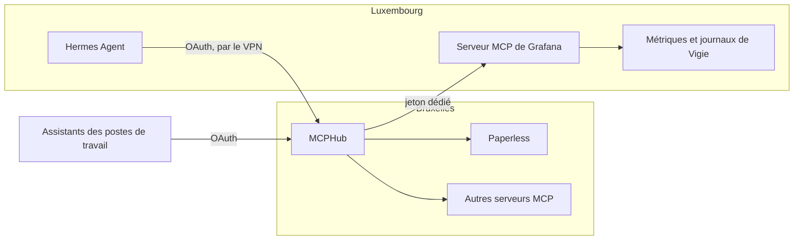

# 🤖 Assistants IA

Les assistants IA (Claude Code, Codex, OpenCode, Antigravity…) accèdent aux outils de l’infrastructure par le protocole [MCP](https://modelcontextprotocol.io/), tous par le même point d’entrée : [MCPHub](https://github.com/samanhappy/mcphub). Quel que soit le fournisseur du modèle, il atteint les mêmes serveurs MCP, avec les mêmes droits.



## 🧭 MCPHub {#mcphub}

MCPHub (<RepositoryReference path="services/mcphub" />) tourne sur Bruxelles, à l’adresse `mcphub.anneraud.fr`, accessible uniquement depuis le réseau local ou le VPN. Il conserve ses serveurs et ses utilisateurs dans sa propre base PostgreSQL, sauvegardée par l’outil de sauvegarde des bases.

- **Connexion :** par [Zitadel](authentification.md) ; le compte `admin` local reste en secours. Une première connexion Zitadel crée un utilisateur ordinaire, nommé d’après son adresse, à promouvoir une fois depuis le compte `admin` (**Users**).
- **Comptes externes :** chaque utilisateur relie lui-même ses comptes aux serveurs qui utilisent OAuth (**Connect** sur le serveur).
- **Partage :** un serveur est privé, partagé avec un groupe ou public.
- **Outils :** chaque outil activé entre dans le contexte du modèle. Seuls les outils utiles restent activés, par exemple uniquement les outils de lecture du serveur de Paperless.

Le coffre `vault/mcphub/vault.yml` (créé avec `mise vault:create`) contient `mcphub_database_password`, `mcphub_jwt_secret`, `mcphub_better_auth_secret` (`openssl rand -hex 32` chacun) et `mcphub_admin_password`, utilisé seulement à la création du premier utilisateur. Le déploiement (`mise deploy services/mcphub/deploy.yml`) provisionne aussi l’application Zitadel, d’où le besoin d’OpenTofu.

## ⚕️ Assistant personnel {#hermes}

[Hermes Agent](https://hermes-agent.nousresearch.com/) (<RepositoryReference path="services/assistant" />) tourne sur Luxembourg. Son tableau de bord est à l’adresse `assistant.anneraud.fr`, accessible uniquement depuis le réseau local ou le VPN. Contrairement aux assistants des postes de travail, il agit seul : il exécute des commandes, lit le web, répond sur Matrix et écrit ses propres compétences à partir de ce qu’il a fait. Une page ou un message peut donc tenter de le détourner (injection de prompt), d’où son isolement :

- **Conteneur :** son image démarre en root pour confier son dossier à l’utilisateur 2000, qui n’a pas de compte sur l’hôte, puis fait tourner la passerelle et le tableau de bord sous cet utilisateur. Il ne garde que les capacités Linux nécessaires à ce passage, avec 2 Go de mémoire et 512 processus au plus.
- **Données :** il ne voit que son dossier, `/opt/assistant/data` : configuration, identifiants, mémoire, compétences et sessions.
- **Docker :** il n’a pas accès au socket Docker. Ses commandes s’exécutent dans son propre conteneur.
- **Réseau :** il n’est joint que par Traefik, et ne sort que vers les fournisseurs de modèles, Matrix et MCPHub.
- **Tableau de bord :** il exige un identifiant et un mot de passe, et ne fait confiance aux en-têtes transmis (adresse et protocole du client) que depuis le réseau de Traefik.

Le coffre `vault/assistant/vault.yml` (créé avec `mise vault:create`) contient :

- `assistant_dashboard_password` (au moins 20 caractères), le mot de passe du tableau de bord, pour l’utilisateur `alix` ;
- `assistant_dashboard_secret` (`openssl rand -hex 32`), qui signe les sessions pour qu’elles survivent aux redémarrages ;
- `assistant_environment`, facultatif : les variables passées au conteneur, comme les clés des fournisseurs ou la connexion à Matrix (`MATRIX_HOMESERVER`, `MATRIX_USER_ID`, `MATRIX_ACCESS_TOKEN`, `MATRIX_ALLOWED_USERS`). Leurs valeurs se limitent aux lettres, aux chiffres et à `._~:/+=@!,-`, car Compose interpréterait `$` et les guillemets.

Après le premier déploiement (`mise deploy services/assistant/deploy.yml`), le modèle et MCPHub se règlent dans le conteneur :

```bash
docker exec -it assistant hermes auth add openai-codex   # abonnement ChatGPT, par un code à saisir
docker exec -it assistant hermes config edit             # MCPHub, voir ci-dessous
docker exec -it assistant hermes mcp login mcphub
```

MCPHub s’ajoute dans `mcp_servers` ; Luxembourg l’atteint par le VPN, comme Vigie atteint Bruxelles :

```yaml
mcp_servers:
  mcphub:
    url: https://mcphub.anneraud.fr/mcp
    auth: oauth
```

T3 Code parle à Hermes par [ACP](https://agentclientprotocol.com/) : il lance la commande `hermes acp` et échange avec elle sur son entrée et sa sortie (**Settings → Providers → Local ACP command**). Cette commande tourne là où tourne T3 Code ; un Hermes installé sur le poste a donc sa propre mémoire, distincte de celle de Luxembourg.

Luxembourg n’est pas encore sauvegardé : le dossier `data` non plus.

La CI (`.github/scripts/check-assistant.sh`) démarre Hermes avec ces réglages et vérifie qu’il tourne avec ses seules capacités, que la passerelle et le tableau de bord ne tournent pas en root, que le réseau de Traefik est approuvé une seule fois, et que le tableau de bord refuse un mauvais mot de passe.

## 💻 Postes de travail {#postes}

`mise deploy hosts/workstations/mcp.yml` branche les assistants du poste sur MCPHub, à l’adresse `https://mcphub.anneraud.fr/mcp` : Claude Code (par sa ligne de commande, pour l’utilisateur), Codex (`~/.codex/config.toml`), OpenCode (`~/.config/opencode/opencode.json`) et Antigravity (`~/.gemini/config/mcp_config.json`).

- Les autres réglages de ces fichiers sont conservés ; un fichier OpenCode commenté doit d’abord perdre ses commentaires.
- Aucune clé n’est écrite : les assistants se connectent par l’OAuth de MCPHub, qui doit être activé dans ses réglages.
- L’adresse `/mcp/$smart`, dont la recherche d’outils a besoin de pgvector et d’un service d’embeddings, n’est pas utilisée.
- Le poste doit être sur le réseau local ou le VPN. Les assistants se redémarrent ensuite.

## 📈 Supervision {#grafana}

Vigie fait tourner le serveur MCP officiel de Grafana (`grafana/mcp-grafana`) à l’adresse `https://vigie.anneraud.fr/mcp`, derrière la liste d’accès interne. Depuis MCPHub, un assistant interroge les métriques (PromQL) et les journaux d’accès de Traefik (LogsQL, avec la source `victorialogs`), lit les tableaux de bord et les règles d’alerte avec leur état. Voir [Supervision](supervision.md#assistant).

- Le serveur n’a aucun outil d’écriture, lit Grafana avec un compte de service en lecture seule et refuse toute requête sans son propre jeton.
- Il ne démarre qu’une fois ses deux jetons dans `vault/vigie/vault.yml`.

Mise en place, une fois :

1. Dans Grafana, en administrateur : **Administration → Users and access → Service accounts → Add service account** `mcp`, rôle **Viewer**, puis **Add service account token** (sans expiration, ou en notant la date).
2. `mise vault vault/vigie/vault.yml` : `vigie_mcp_grafana_token` (ce jeton) et `vigie_mcp_server_token` (`openssl rand -hex 32`), puis valider le coffre et son sous-module.
3. `mise deploy services/vigie/deploy.yml` : le conteneur `mcp` démarre.
4. Dans MCPHub (**Servers → Add**) : type Streamable HTTP, adresse `https://vigie.anneraud.fr/mcp`, en-tête `Authorization` = `Bearer <vigie_mcp_server_token>`. Tout utilisateur de MCPHub qui reçoit ce serveur voit toutes les métriques de Vigie : il reste dans le groupe du propriétaire.
