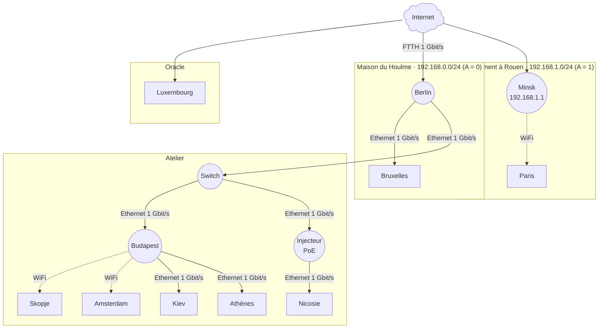
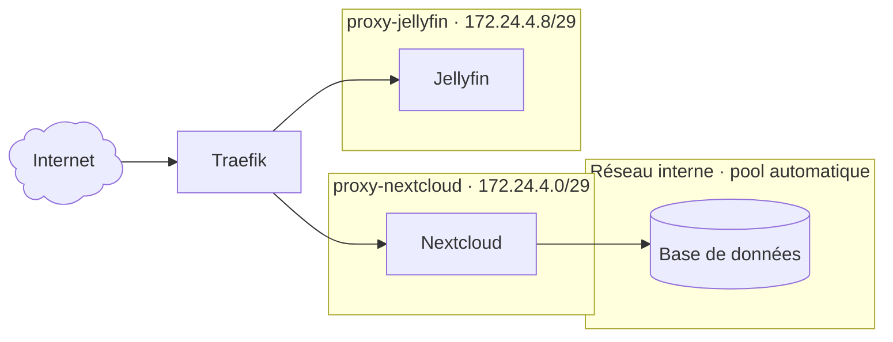

# 🗺️ Réseau

## 🌎 Schéma général

## 🧭 Détail

### 🧩 Plan d’adressage commun

Plan par lieu : `192.168.A.0/24` (`A = 0` au Houlme, `A = 1` à Rouen). Sous-réseaux fonctionnels proposés, compatibles avec les adresses attribuées :

| Fonction                                    | Sous-réseau(x)     | Plage d’adresses utilisables    |
| ------------------------------------------- | ------------------ | ------------------------------- |
| Infrastructure                              | `192.168.A.0/28`   | `192.168.A.1`–`192.168.A.14`    |
| Serveurs                                    | `192.168.A.16/28`  | `192.168.A.17`–`192.168.A.30`   |
| Caméras                                     | `192.168.A.40/29`  | `192.168.A.41`–`192.168.A.46`   |
| Imprimantes et autres équipements statiques | `192.168.A.48/28`  | `192.168.A.49`–`192.168.A.62`   |
| Clients DHCP                                | `192.168.A.128/25` | `192.168.A.129`–`192.168.A.254` |

> Ces sous-réseaux fonctionnels sont proposés, pas configurés : le LAN du Houlme et son macvlan restent en `192.168.0.0/24` (passerelle `.254`). Leur séparation nécessiterait routage et passerelles dédiées, éventuellement des VLAN.

### 🔐 VPN mesh NetBird

NetBird utilise `100.64.0.0/24` (hôtes `100.64.0.1`–`100.64.0.254`), indépendamment des réseaux locaux.

### 🐳 Réseaux Docker

Docker attribue un sous-réseau à chaque réseau créé sans sous-réseau explicite, à partir de ses _pools d’adresses_. Le plan découpe la plage privée `172.16.0.0/12` ([RFC 1918](https://www.rfc-editor.org/rfc/rfc1918)) en deux moitiés, identiques sur Bruxelles et Luxembourg :

| Plage                               | Usage                                                                            | Taille des réseaux | Capacité                        |
| ----------------------------------- | -------------------------------------------------------------------------------- | ------------------ | ------------------------------- |
| `172.16.0.0/13` (`172.16`–`172.23`) | Pool automatique de Docker : réseaux internes des applications, bases de données | `/24`              | 2 048 réseaux de 253 conteneurs |
| `172.24.0.0/13` (`172.24`–`172.31`) | Réservé aux sous-réseaux fixes, jamais attribué automatiquement                  | —                  | —                               |
| ↳ `172.24.0.0/22`                   | Réseaux proxy de Luxembourg _(prévu)_                                            | `/29`              | 128 réseaux de 5 conteneurs     |
| ↳ `172.24.4.0/22`                   | Réseaux proxy de Bruxelles _(prévu)_                                             | `/29`              | 128 réseaux de 5 conteneurs     |
| `fdd0::/48`                         | Pool IPv6, pour les réseaux qui activent IPv6                                    | `/64`              | 65 536 réseaux                  |

| Hôte       | Où se règle le pool                                                         | État                                                                                |
| ---------- | --------------------------------------------------------------------------- | ----------------------------------------------------------------------------------- |
| Bruxelles  | TrueNAS : Apps → Installed → Configuration → Settings → Address Pools       | `172.16.0.0/13`, taille 24, appliqué le 1er novembre 2026 (avant : `172.17.0.0/12`) |
| Luxembourg | `default-address-pools` dans `/etc/docker/daemon.json`, à gérer par Ansible | À aligner, voir [changements prévus](#changements-prevus)                           |

> **Pourquoi `/29` :** Docker réserve l’adresse de réseau et celle de broadcast ([Moby](https://git.causa-arcana.com/kotovalexarian-likes-github/moby--moby/commit/3a938df4b570aad3bfb4d5342379582e872fc1a3)), et la passerelle occupe une adresse sur le pont ([Docker](https://docs.docker.com/engine/network/drivers/bridge/)). Il reste 5 adresses : Traefik et jusqu’à 4 conteneurs de l’application. Un `/30` n’en laisserait qu’une.
>
> **Pourquoi une plage réservée :** Docker ne permet pas de choisir le pool d’un réseau, et un sous-réseau fixe ne doit chevaucher aucun réseau existant, sinon la création échoue ([Docker](https://docs.docker.com/reference/cli/docker/network/create/)). Les sous-réseaux fixes vivent donc hors du pool automatique. La taille `/24` du pool automatique est la valeur courante ([Docker](https://docs.docker.com/engine/network/), défaut TrueNAS) ; le découpage en deux moitiés est propre à cette infrastructure.

#### Isolation des applications _(prévu)_

Aujourd’hui, chaque hôte a un seul réseau proxy partagé par toutes les applications : `proxy` sur Bruxelles (`172.16.44.0/24`), `traefik` sur Luxembourg (`172.22.0.0/16`). Sur un même réseau, les conteneurs voient tous les ports les uns des autres ([Docker](https://docs.docker.com/engine/network/drivers/bridge/)) : une application compromise peut joindre directement les autres, sans passer par Traefik ni par ses protections (liste d’accès interne, CrowdSec, connexion).

Cible : un réseau `/29` par application, partagé uniquement par Traefik et le conteneur qu’il dessert, comme le recommande l’[OWASP](https://cheatsheetseries.owasp.org/cheatsheets/Docker_Security_Cheat_Sheet.html) (règle n° 5). Chaque application reçoit un numéro d’emplacement fixe dans l’inventaire, jamais réutilisé, dont Ansible déduit le sous-réseau. Ces réseaux sont marqués `internal` (aucune sortie vers Internet) ; les bases de données restent sur le réseau interne de l’application.

> Nextcloud et Jellyfin ne partagent aucun réseau : ils ne peuvent plus se joindre directement. Les noms et emplacements du schéma sont des exemples. Traefik reste relié à tous les réseaux proxy : sa compromission donnerait toujours accès à toutes les applications.

### 🗼 Infrastructure

> **DHCP :** Berlin et Minsk servent chacun le DHCP de leur réseau local respectif. Les autres équipements réseau fonctionnent en pont L2, sans routage, NAT, VLAN ni DHCP.

| Nom                                  | Adresse IP                        | Description               | Adresse MAC       |
| ------------------------------------ | --------------------------------- | ------------------------- | ----------------- |
| [Berlin](./inventaire.md#berlin)     | [192.168.0.1](http://192.168.0.1) | Routeur fibre             | 88:40:3B:EA:10:46 |
| [Minsk](./inventaire.md#minsk)       | [192.168.1.1](http://192.168.1.1) | Routeur de l’appartement  |                   |
| [Budapest](./inventaire.md#budapest) | [192.168.0.2](http://192.168.0.2) | Routeur wifi atelier      |                   |
| [Chisinau](./inventaire.md#chisinau) | [192.168.0.3](http://192.168.0.3) | Antenne WiFi ext. caméras | 60:A4:B7:39:6A:0E |

### 🌐 Serveurs

| Nom                                      | Adresse IP                          | Description                                                                      | Adresse MAC |
| ---------------------------------------- | ----------------------------------- | -------------------------------------------------------------------------------- | ----------- |
| [Bruxelles](./inventaire.md#bruxelles)   | [192.168.0.21](http://192.168.0.21) | Serveur TrueNAS                                                                  |             |
| [Pristina](./inventaire.md#pristina)     | [192.168.0.22](http://192.168.0.22) | Serveur Debian de sauvegarde (virtualisé sur [Athènes](./inventaire.md#athenes)) |             |
| [Luxembourg](./inventaire.md#luxembourg) | [192.168.2.16](http://192.168.2.16) | Adresse loopback configurée sur le serveur Oracle Cloud                          |             |
| Home Assistant                           | [192.168.0.24](http://192.168.0.24) | Conteneur macvlan hébergé sur [Bruxelles](./inventaire.md#bruxelles)             |             |

### 🎥 Caméras

| Nom                                    | Adresse IP                          | Description         | Adresse MAC       |
| -------------------------------------- | ----------------------------------- | ------------------- | ----------------- |
| [Nicosie](./inventaire.md#nicosie)     | [192.168.0.41](http://192.168.0.41) | Caméra jardin       | EC:71:DB:AC:02:02 |
| [Amsterdam](./inventaire.md#amsterdam) | [192.168.0.42](http://192.168.0.42) | Caméra portail haut | C4:3C:B0:F1:8C:C7 |
| [Skopje](./inventaire.md#skopje)       | [192.168.0.43](http://192.168.0.43) | Caméra cours        | 00:BF:AF:D5:A2:5C |

### 🖨️ Imprimantes

| Nom                              | Adresse IP                           | Description             | Adresse MAC       |
| -------------------------------- | ------------------------------------ | ----------------------- | ----------------- |
| [Madrid](./inventaire.md#madrid) | [192.168.0.51](https://192.168.0.51) | Imprimante chambre Alix | 38:9D:92:07:EB:DC |
| [Kiev](./inventaire.md#kiev)     | [192.168.0.52](https://192.168.0.52) | Imprimante atelier      |                   |

### ➕ Autre - statique

| Nom                            | Adresse IP                          | Description          | Adresse MAC       |
| ------------------------------ | ----------------------------------- | -------------------- | ----------------- |
| [Paris](./inventaire.md#paris) | [192.168.1.61](http://192.168.1.61) | Ordinateur de bureau | 34:2E:B7:8A:D9:E1 |

_Voir [inventaire.md](./inventaire.md) pour la liste détaillée complète et les descriptions individualisées._

## 🚧 Changements prévus {#changements-prevus}

Relevé des réseaux Docker du 1er novembre 2026 et travaux décidés, dans l’ordre prévu :

1. **Protection CrowdSec** _(fusionné, à déployer)_ : un moteur CrowdSec sur Luxembourg lit les journaux de Traefik et bannit les adresses qui scannent ou forcent des connexions ; Traefik refuse ces adresses sur toutes les routes, internes comprises. Le LAN et le VPN ne sont jamais bannis. Bruxelles suivra.
2. **Limitation des connexions** _(fusionné, à déployer)_ : nombre limité d’envois de formulaires de connexion par adresse sur les services publics (Zitadel, Vaultwarden, Nextcloud, Jellyfin, Home Assistant, Tolgee, NetBird). La synchronisation des applications n’est pas concernée.
3. **MeshCentral devient privé** _(fusionné, à déployer)_ : `parc.anneraud.fr` ne sera plus accessible que depuis le LAN ou le VPN. Les agents hors LAN et hors VPN perdront la connexion.
4. **Aligner le pool de Luxembourg** sur celui de Bruxelles (`172.16.0.0/13`, taille 24), puis recréer les réseaux hors plan :
   - `gatus_anneraud_database`, `gatus_derapage_database`, `matrix_dera_page_internal` et `tolgee_anneraud_internal` sont en `172.80.x.0/24`, en dehors de la plage privée : ces adresses appartiennent à Internet, et les conteneurs concernés ne pourraient pas joindre un vrai serveur qui les utilise ;
   - `ldap_internal`, `overleaf_default` et `weblate_anneraud_internal` correspondent à des services retirés et peuvent être supprimés.
5. **Réseaux proxy par application** sur les deux hôtes, en commençant par les services publics (Nextcloud, Jellyfin, Home Assistant, Vaultwarden, Matrix), puis les autres. Les applications qui font confiance au proxy (Wakapi, aujourd’hui sur tout `172.16.0.0/16`) ne feront plus confiance qu’à leur propre réseau `/29`.
6. **Un réseau par base de données** à la place du réseau partagé `databases` (`172.16.34.0/24` sur Bruxelles) : Databasus rejoindra chaque réseau, mais les bases ne se verront plus entre elles.
7. **Supprimer `ix-nginx-proxy-manager_default`** sur Bruxelles, reste de l’ancien proxy.
