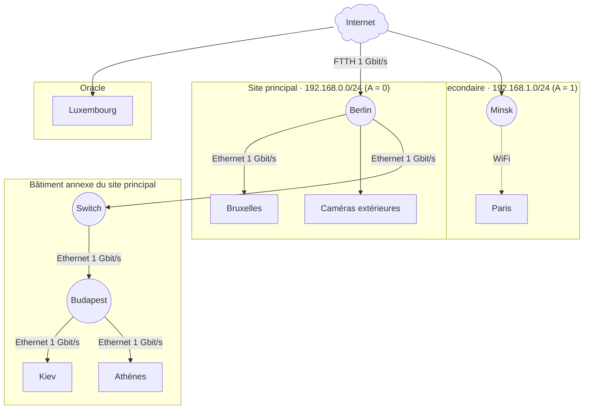
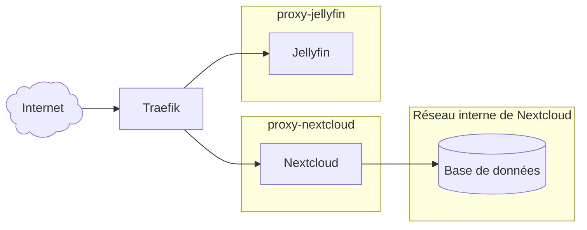

# 🗺️ Réseau

Cette page décrit les réseaux de l’infrastructure : sites, VPN et réseaux Docker. Les équipements eux-mêmes sont listés dans l’[inventaire](inventaire.md).

## 🌎 Schéma général {#schema}

> **DHCP :** Berlin et Minsk servent chacun le DHCP de leur réseau local respectif. Les autres équipements réseau fonctionnent en pont L2, sans routage, NAT, VLAN ni DHCP.

## 🧩 Plan d’adressage des sites {#plan-adressage}

Plan par site : `192.168.A.0/24` (`A = 0` sur le site principal, `A = 1` sur le site secondaire). Sous-réseaux fonctionnels proposés, compatibles avec les adresses attribuées :

| Fonction                                    | Sous-réseau(x)     | Plage d’adresses utilisables    |
| ------------------------------------------- | ------------------ | ------------------------------- |
| Infrastructure                              | `192.168.A.0/28`   | `192.168.A.1`–`192.168.A.14`    |
| Serveurs                                    | `192.168.A.16/28`  | `192.168.A.17`–`192.168.A.30`   |
| Caméras                                     | `192.168.A.40/29`  | `192.168.A.41`–`192.168.A.46`   |
| Imprimantes et autres équipements statiques | `192.168.A.48/28`  | `192.168.A.49`–`192.168.A.62`   |
| Clients DHCP                                | `192.168.A.128/25` | `192.168.A.129`–`192.168.A.254` |

> Ces sous-réseaux fonctionnels sont proposés, pas configurés : le réseau local du site principal et son macvlan restent en `192.168.0.0/24`. Leur séparation nécessiterait routage et passerelles dédiées, éventuellement des VLAN.

## 🔐 VPN NetBird {#vpn-mesh-netbird}

NetBird utilise `100.64.0.0/16` (hôtes `100.64.0.1`–`100.64.254.254`), indépendamment des réseaux locaux. Son rôle est décrit dans la page [Architecture](architecture.md#vpn).

## 🐳 Réseaux Docker {#reseaux-docker}

Docker attribue un sous-réseau à chaque réseau créé sans sous-réseau explicite, à partir de ses _pools d’adresses_. Aucun réseau de l’infrastructure n’a de sous-réseau fixe : tous viennent de ces pools, dans la plage privée `172.16.0.0/12` ([RFC 1918](https://www.rfc-editor.org/rfc/rfc1918)).

| Hôte       | Pool                                                     | Où il se règle                                                                  |
| ---------- | -------------------------------------------------------- | ------------------------------------------------------------------------------- |
| Bruxelles  | `172.16.0.0/13` en `/24`, et `fdd0::/48` en `/64` (IPv6) | Interface TrueNAS : Apps → Installed → Configuration → Settings → Address Pools |
| Luxembourg | `172.16.0.0/12` en `/24`                                 | `default-address-pools` dans `/etc/docker/daemon.json`, écrit à la main         |

La taille `/24` est la valeur courante ([Docker](https://docs.docker.com/engine/network/), défaut TrueNAS). L’alignement de Luxembourg sur Bruxelles figure dans la [feuille de route](feuille-de-route.md#reseaux).

### 🧱 Isolation des applications {#isolation-des-applications}

Sur un même réseau Docker, les conteneurs voient tous les ports les uns des autres ([Docker](https://docs.docker.com/engine/network/drivers/bridge/)). Un réseau proxy partagé par toutes les applications permettrait donc à une application compromise de joindre les autres sans passer par Traefik ni par ses protections (liste d’accès interne, CrowdSec, limitation des connexions).

Chaque application a donc son propre réseau proxy, `proxy-<application>`, partagé uniquement par Traefik et le conteneur qu’il dessert, comme le recommande l’[OWASP](https://cheatsheetseries.owasp.org/cheatsheets/Docker_Security_Cheat_Sheet.html) (règle n° 5) :

- **Sous-réseau :** pris dans le pool automatique, comme tous les réseaux. Les applications qui font confiance aux en-têtes transmis par le proxy (Hermes, NetBird) lisent ce sous-réseau au déploiement et ne font confiance qu’à lui.
- **Sortie :** le réseau proxy n’est pas `internal`, l’application sort sur Internet par lui. Les bases de données restent sur le réseau interne de leur application, que Traefik ne rejoint pas.
- **Traefik :** chaque déploiement d’application crée son réseau et y relie Traefik à chaud, sans le redémarrer. Ces réseaux portent l’étiquette `anneraud.proxy=true` : quand Traefik est recréé, son propre déploiement le relie de nouveau à tous. Chaque conteneur routé indique son réseau (`traefik.docker.network`) et son port, et la CI le vérifie.
- **Métriques :** Vigie lit les métriques de Traefik sur un réseau interne qui ne relie qu’eux deux, `traefik-metrics`, et celles de Gatus sur le réseau interne des collecteurs, `metriques`.

> Nextcloud et Jellyfin ne partagent aucun réseau : ils ne peuvent pas se joindre directement. Traefik reste relié à tous les réseaux proxy : sa compromission donnerait toujours accès à toutes les applications.

**Applications qui s’appellent entre elles.** Quelques applications de Bruxelles se joignent par leur nom de conteneur. Elles partagent un réseau `liaison-<usage>`, `internal` et sans Traefik, déclaré dans <RepositoryReference path="inventory/host_vars/bruxelles/applications.yml" /> :

| Réseau                   | Applications                                                                                       |
| ------------------------ | -------------------------------------------------------------------------------------------------- |
| `liaison-telechargement` | qBittorrent (gluetun), Prowlarr, FlareSolverr, Radarr, Sonarr, Bazarr, Seerr, Jellyfin             |
| `liaison-recherche`      | Open WebUI, SearXNG                                                                                |
| `liaison-automatisation` | MCPHub, n8n                                                                                        |
| `sortie-flaresolverr`    | FlareSolverr seul : sa sortie vers Internet, faute de réseau proxy (pas de route) ; non `internal` |

**Applications TrueNAS.** Leur compose appartient à TrueNAS : le déploiement de Traefik (<RepositoryReference path="services/proxy/deploy.yml" />) crée leurs réseaux, nommés par le champ `network` de chaque route de <RepositoryReference path="inventory/host_vars/bruxelles/traefik.yml" />, ainsi que les réseaux de liaison. Chaque application les rejoint dans ses réglages TrueNAS. Pour une nouvelle application :

1. Ajouter sa route avec `network: proxy-<application>` (le nom de l’application TrueNAS), puis déployer Traefik : `mise deploy services/proxy/deploy.yml --limit bruxelles`.
2. Dans TrueNAS, réglages de l’application, réseau : rejoindre `proxy-<application>`, et son réseau `liaison-…` si elle en a un.

Il n’existe plus de réseau proxy partagé : Traefik n’a pas de réseau par défaut, chaque conteneur routé désigne le sien.
