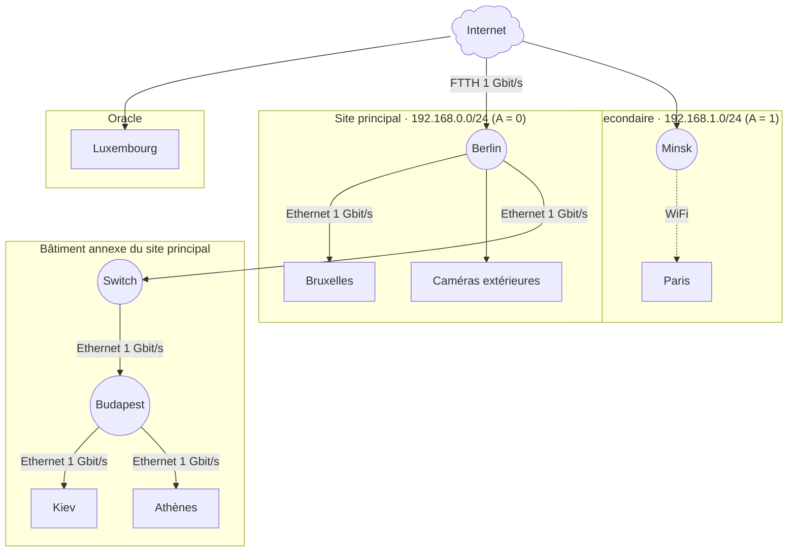
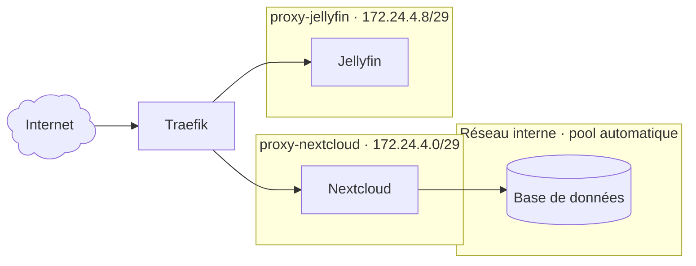

# 🗺️ Réseau

## 🌎 Schéma général

## 🧭 Détail

### 🧩 Plan d’adressage commun

Plan par site : `192.168.A.0/24` (`A = 0` sur le site principal, `A = 1` sur le site secondaire). Sous-réseaux fonctionnels proposés, compatibles avec les adresses attribuées :

| Fonction                                    | Sous-réseau(x)     | Plage d’adresses utilisables    |
| ------------------------------------------- | ------------------ | ------------------------------- |
| Infrastructure                              | `192.168.A.0/28`   | `192.168.A.1`–`192.168.A.14`    |
| Serveurs                                    | `192.168.A.16/28`  | `192.168.A.17`–`192.168.A.30`   |
| Caméras                                     | `192.168.A.40/29`  | `192.168.A.41`–`192.168.A.46`   |
| Imprimantes et autres équipements statiques | `192.168.A.48/28`  | `192.168.A.49`–`192.168.A.62`   |
| Clients DHCP                                | `192.168.A.128/25` | `192.168.A.129`–`192.168.A.254` |

> Ces sous-réseaux fonctionnels sont proposés, pas configurés : le LAN du site principal et son macvlan restent en `192.168.0.0/24`. Leur séparation nécessiterait routage et passerelles dédiées, éventuellement des VLAN.

### 🔐 VPN mesh NetBird {#vpn-mesh-netbird}

NetBird utilise `100.64.0.0/24` (hôtes `100.64.0.1`–`100.64.0.254`), indépendamment des réseaux locaux.

### 🐳 Réseaux Docker {#reseaux-docker}

Docker attribue un sous-réseau à chaque réseau créé sans sous-réseau explicite, à partir de ses _pools d’adresses_. Le plan découpe la plage privée `172.16.0.0/12` ([RFC 1918](https://www.rfc-editor.org/rfc/rfc1918)) en deux moitiés, identiques sur Bruxelles et Luxembourg :

| Plage                               | Usage                                                                            | Taille des réseaux | Capacité                        |
| ----------------------------------- | -------------------------------------------------------------------------------- | ------------------ | ------------------------------- |
| `172.16.0.0/13` (`172.16`–`172.23`) | Pool automatique de Docker : réseaux internes des applications, bases de données | `/24`              | 2 048 réseaux de 253 conteneurs |
| `172.24.0.0/13` (`172.24`–`172.31`) | Réservé aux sous-réseaux fixes, jamais attribué automatiquement                  | —                  | —                               |
| ↳ `172.24.0.0/22`                   | Réseaux proxy de Luxembourg _(prévu)_                                            | `/29`              | 128 réseaux de 5 conteneurs     |
| ↳ `172.24.4.0/22`                   | Réseaux proxy de Bruxelles _(prévu)_                                             | `/29`              | 128 réseaux de 5 conteneurs     |
| `fdd0::/48`                         | Pool IPv6, pour les réseaux qui activent IPv6                                    | `/64`              | 65 536 réseaux                  |

| Hôte       | Où se règle le pool                                                                |
| ---------- | ---------------------------------------------------------------------------------- |
| Bruxelles  | Interface TrueNAS : Apps → Installed → Configuration → Settings → Address Pools    |
| Luxembourg | `default-address-pools` dans `/etc/docker/daemon.json`, géré par Ansible _(prévu)_ |

L’alignement des deux hôtes sur ce plan figure dans la [feuille de route](feuille-de-route.md#reseaux).

> **Pourquoi `/29` :** Docker réserve l’adresse de réseau et celle de broadcast ([Moby](https://git.causa-arcana.com/kotovalexarian-likes-github/moby--moby/commit/3a938df4b570aad3bfb4d5342379582e872fc1a3)), et la passerelle occupe une adresse sur le pont ([Docker](https://docs.docker.com/engine/network/drivers/bridge/)). Il reste 5 adresses : Traefik et jusqu’à 4 conteneurs de l’application. Un `/30` n’en laisserait qu’une.
>
> **Pourquoi une plage réservée :** Docker ne permet pas de choisir le pool d’un réseau, et un sous-réseau fixe ne doit chevaucher aucun réseau existant, sinon la création échoue ([Docker](https://docs.docker.com/reference/cli/docker/network/create/)). Les sous-réseaux fixes vivent donc hors du pool automatique. La taille `/24` du pool automatique est la valeur courante ([Docker](https://docs.docker.com/engine/network/), défaut TrueNAS) ; le découpage en deux moitiés est propre à cette infrastructure.

#### Isolation des applications _(prévu)_ {#isolation-des-applications}

Sur un même réseau Docker, les conteneurs voient tous les ports les uns des autres ([Docker](https://docs.docker.com/engine/network/drivers/bridge/)). Un réseau proxy partagé par toutes les applications permettrait donc à une application compromise de joindre les autres sans passer par Traefik ni par ses protections (liste d’accès interne, CrowdSec, limitation des connexions).

Cible : un réseau `/29` par application, partagé uniquement par Traefik et le conteneur qu’il dessert, comme le recommande l’[OWASP](https://cheatsheetseries.owasp.org/cheatsheets/Docker_Security_Cheat_Sheet.html) (règle n° 5). Chaque application reçoit un numéro d’emplacement fixe dans l’inventaire, jamais réutilisé, dont Ansible déduit le sous-réseau. Ces réseaux sont marqués `internal` (aucune sortie vers Internet) ; les bases de données restent sur le réseau interne de l’application. Les applications qui font confiance aux en-têtes transmis par le proxy ne font plus confiance qu’à leur propre réseau `/29`.

> Nextcloud et Jellyfin ne partagent aucun réseau : ils ne peuvent pas se joindre directement. Les noms et emplacements du schéma sont des exemples. Traefik reste relié à tous les réseaux proxy : sa compromission donnerait toujours accès à toutes les applications.

### 🗼 Infrastructure

> **DHCP :** Berlin et Minsk servent chacun le DHCP de leur réseau local respectif. Les autres équipements réseau fonctionnent en pont L2, sans routage, NAT, VLAN ni DHCP.

| Nom                                  | Description                             |
| ------------------------------------ | --------------------------------------- |
| [Berlin](./inventaire.md#berlin)     | Routeur fibre du site principal         |
| [Minsk](./inventaire.md#minsk)       | Routeur du site secondaire              |
| [Sofia](./inventaire.md#sofia)       | Switch du bâtiment annexe               |
| [Budapest](./inventaire.md#budapest) | Routeur Wi-Fi du bâtiment annexe (pont) |

### 🌐 Serveurs

| Nom                                      | Description                                                                      |
| ---------------------------------------- | -------------------------------------------------------------------------------- |
| [Bruxelles](./inventaire.md#bruxelles)   | Serveur TrueNAS                                                                  |
| [Pristina](./inventaire.md#pristina)     | Serveur Debian de sauvegarde (virtualisé sur [Athènes](./inventaire.md#athenes)) |
| [Luxembourg](./inventaire.md#luxembourg) | Serveur Oracle Cloud, avec une adresse privée sur une interface loopback         |
| Home Assistant                           | Conteneur macvlan hébergé sur [Bruxelles](./inventaire.md#bruxelles)             |

### 🎥 Caméras

Des [caméras de surveillance extérieures](./inventaire.md#cameras) sont reliées au réseau local du site principal.

### 🖨️ Imprimantes

| Nom                              | Description                         |
| -------------------------------- | ----------------------------------- |
| [Madrid](./inventaire.md#madrid) | Imprimante à jet d’encre            |
| [Kiev](./inventaire.md#kiev)     | Imprimante laser du bâtiment annexe |

### ➕ Autre - statique

| Nom                            | Description          |
| ------------------------------ | -------------------- |
| [Paris](./inventaire.md#paris) | Ordinateur de bureau |

_Voir [inventaire.md](./inventaire.md) pour la liste détaillée complète et les descriptions individualisées._
