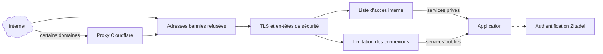

# 🔒 Sécurité

La sécurité repose sur plusieurs couches indépendantes : une requête doit franchir chacune d’elles avant d’atteindre un service, et aucune ne suffit seule. Cette page décrit leur conception ; les travaux en cours sont listés dans la [feuille de route](feuille-de-route.md).



## ☁️ Proxy Cloudflare {#cloudflare}

Les sites `minitrainstore.fr` et `guenola-sahut.fr` passent par le proxy de Cloudflare, qui absorbe une partie du trafic indésirable avant qu’il n’atteigne Bruxelles. Pour que ce filtre ne puisse pas être contourné, Traefik refuse sur ces sites toute connexion qui ne vient pas des plages d’adresses publiées par Cloudflare. Les autres domaines pointent directement vers les serveurs.

## 🚪 Points d’entrée Traefik {#traefik}

Chaque hôte a un seul point d’entrée web, Traefik. Les protections communes sont attachées au point d’entrée HTTPS lui-même, et non route par route : un nouveau service les reçoit sans configuration, qu’il soit déclaré par étiquettes Docker ou dans les fichiers de routes.

- **HTTPS partout :** HTTP redirige vers HTTPS. TLS 1.2 au minimum, avec uniquement des suites à échange de clés éphémère (ECDHE) et chiffrement authentifié (AES-GCM, ChaCha20). Un nom inconnu ne reçoit aucun certificat par défaut.
- **En-têtes de sécurité :** HSTS sur chaque site HTTPS, et interdiction de deviner le type des contenus (`nosniff`). HSTS n’est pas étendu aux sous-domaines : il forcerait HTTPS sur des appareils du réseau local qui ne parlent que HTTP.
- **En-têtes falsifiés :** les variantes d’en-têtes de transfert écrites avec des tirets bas sont supprimées, pour qu’un client ne puisse pas se faire passer pour une autre adresse.

### 🧱 CrowdSec {#crowdsec}

[CrowdSec](https://www.crowdsec.net/) lit le journal d’accès de Traefik, détecte les comportements hostiles (balayages, tentatives de connexion en force, recherche de vulnérabilités connues) et bannit les adresses en cause. Il reçoit aussi la liste de blocage communautaire de CrowdSec. Un module de Traefik (_bouncer_) consulte ces décisions et refuse les adresses bannies avant toute autre étape, sur toutes les routes, privées comprises.

- Le réseau local, le VPN et la plage privée de Docker (`172.16.0.0/12`) ne sont jamais bannis : ils sont exclus des décisions de CrowdSec, et le module les laisse toujours passer. La plage de Docker couvre les conteneurs qui joignent les noms publics d’un hôte et reviennent par Traefik depuis la passerelle de leur réseau, comme Home Assistant sur Bruxelles.
- Les adresses publiques de la maison et de Luxembourg ne sont jamais bannies non plus : les appareils de la maison et les clients NetBird qui s’y trouvent sortent par l’adresse de la maison, et Gatus vérifie les routes publiques de Bruxelles depuis Luxembourg. L’adresse de la maison change (FTTH Orange, tenue à jour par un client DNS dynamique) : aucune adresse n’est écrite dans le dépôt, CrowdSec résout leurs noms à chaque détection et ignore l’alerte quand la source est l’une de leurs adresses, ou dans le `/64` de l’une de leurs adresses IPv6. Une nouvelle adresse est reconnue dès que l’enregistrement DNS change, sans redéploiement.
- Certaines applications produisent en usage normal des erreurs qui ressemblent à un balayage : un client Matrix demande l’aperçu de liens vers des pages disparues, Nextcloud et Jellyfin des vignettes absentes. Ces requêtes sont ignorées par les listes blanches du hub de CrowdSec pour Nextcloud, Jellyfin et Jellyseerr, et par une liste du dépôt pour Matrix (<RepositoryReference path="services/protection/matrix_whitelist.yaml" />, erreurs `400`, `403` et `404` sous `/_matrix/`, sauf la connexion). Les robots des moteurs de recherche, les adresses de Cloudflare et les résolveurs DNS publics ne sont jamais bannis (`crowdsecurity/whitelist-good-actors`). Un nouveau faux positif se diagnostique avec `cscli alerts inspect <id> --details`, qui donne le scénario et les requêtes en cause.
- Derrière Cloudflare, c’est l’adresse réelle du visiteur qui est vérifiée, pas celle de Cloudflare.
- Les clients IPv6 gardent leur propre adresse : Traefik publie ses ports par un réseau Docker double pile. Sur un réseau IPv4 seul, Docker relaierait chaque client IPv6 depuis une même adresse à lui : un bannissement ou une limite de connexion les toucherait tous à la fois. Le déploiement de Traefik vérifie ce réglage.
- L’API de CrowdSec n’est joignable que par Traefik, sur un réseau Docker réservé ; CrowdSec lit les journaux par une vue en lecture seule de l’API Docker, limitée à la liste des conteneurs et à leurs journaux.

CrowdSec protège les deux hôtes, chacun avec sa propre instance.

#### Exploitation {#crowdsec-exploitation}

CrowdSec est <RepositoryReference path="services/protection" />, déployé sur les hôtes du groupe `protection` ; le module de Traefik est l’intergiciel `crowdsec@file` de <RepositoryReference path="services/proxy/protection.yml.j2" />. Un bannissement dure 4 heures.

- **Prérequis :** le coffre `vault/protection/vault.yml` contient `protection_bouncer_key`, la clé du module de Traefik (`openssl rand -hex 32`), et éventuellement `protection_enrollment_key` pour inscrire le moteur dans la [console CrowdSec](https://app.crowdsec.net) (l’accepter ensuite dans la console, puis `docker restart crowdsec`). Le déploiement de Traefik lit ce coffre sur chaque hôte : il doit exister.
- **Ordre de déploiement :** Traefik d’abord (`mise deploy services/proxy/deploy.yml --limit <hôte>`), puis CrowdSec (`mise deploy services/protection/deploy.yml --limit <hôte>`), puis Vigie (`mise deploy services/vigie/deploy.yml`), dont les collectes et les règles d’alerte suivent le groupe `protection`. Pour un nouvel hôte, l’ajouter au groupe `protection` de l’inventaire, lui donner un `metriques_host` si Vigie n’y tourne pas, puis déployer les trois.
- **Réseaux et hôtes de confiance :** `protection_trusted_networks` (réseaux de la liste d’accès interne et plage de Docker) et `protection_trusted_hosts` (noms DNS des hôtes) dans <RepositoryReference path="inventory/group_vars/all.yml" /> ; la liste blanche résolue par CrowdSec est <RepositoryReference path="services/protection/trusted_hosts.yaml.j2" />. Elle ne couvre que les détections de CrowdSec : si la liste de blocage communautaire contenait un jour l’une de ces adresses, lever le bannissement à la main (`cscli decisions delete --ip`). Ne jamais écrire une adresse publique des hôtes dans le dépôt.
- **Module indisponible :** Traefik télécharge le module depuis plugins.traefik.io à son démarrage. Si le téléchargement échoue, toutes les routes de l’hôte répondent `404` : redémarrer Traefik (`docker restart traefik`) une fois le site revenu, ou retirer l’hôte du groupe `protection` et redéployer Traefik. Dependabot ne suit pas la version du module.
- **Changer la clé du module :** mettre à jour le coffre, `docker exec crowdsec cscli bouncers delete traefik`, déployer CrowdSec puis Traefik, puis `docker restart traefik`.

Sur l’hôte :

```bash
docker exec crowdsec cscli decisions list                  # bannissements en cours
docker exec crowdsec cscli decisions delete --ip <adresse> # lever un bannissement (pris en compte en 15 s)
docker exec crowdsec cscli alerts list                     # ce qui a été détecté
docker exec crowdsec cscli allowlists inspect internal     # adresses jamais bannies
```

Pour voir les adresses clientes que Traefik journalise sur un hôte, IPv6 comprise :

```bash
sudo docker logs traefik --since 30m 2>&1 | grep -o '"ClientHost":"[^"]*"' | sort | uniq -c | sort -rn | head
```

### 🏠 Services privés {#services-prives}

Les services privés n’acceptent que les connexions venant du réseau local ou du VPN NetBird, grâce à une liste d’accès appliquée par Traefik. Elle vérifie l’adresse de la connexion elle-même, et non les en-têtes transmis : faire confiance aux en-têtes de Cloudflare, pour transmettre l’adresse du visiteur aux applications, ne l’élargit pas. Leur nom DNS pointe en plus vers une adresse du réseau local. Les outils d’administration en font partie : consoles des serveurs et des conteneurs, tableau de bord de Traefik, supervision, déploiement, coffre de signature de Xila.

### ⏱️ Limitation des connexions {#limitation}

Sur les services publics, les formulaires de connexion sont limités par adresse cliente : au-delà d’un certain nombre de tentatives, Traefik répond `429 Too Many Requests`. Seuls les envois de formulaires de connexion sont comptés, si bien que la synchronisation des applications (Nextcloud, Jellyfin, Home Assistant, Bitwarden…) n’est pas ralentie ; les limites propres à chaque application s’ajoutent à celle-ci. Sont concernés : Zitadel, Vaultwarden, Nextcloud, Jellyfin, Home Assistant, Tolgee et NetBird.

## 🪪 Authentification unique {#authentification}

[Zitadel](https://zitadel.com/) centralise l’identité des utilisateurs. Les services raccordés délèguent la connexion à Zitadel en OpenID Connect, avec PKCE par défaut, et les droits dans chaque service découlent des rôles attribués dans Zitadel. Les applications OIDC sont déclarées dans le dépôt et créées par OpenTofu (voir [Architecture](architecture.md#authentification)).

## 🔑 Accès SSH {#ssh}

- **Compte d’automatisation dédié :** Ansible se connecte avec un compte réservé, distinct des comptes personnels, par clé SSH uniquement. Son mot de passe est verrouillé ; il dispose de `sudo` sans mot de passe pour les déploiements.
- **Clés restreintes :** chaque clé autorisée sur ce compte n’est acceptée que depuis les réseaux privés de l’infrastructure, et aucune autre clé n’est conservée. Le playbook qui le configure refuse de s’exécuter depuis une connexion qui ne viendrait pas de ces réseaux, pour ne jamais se couper l’accès.
- **`sshd` durci :** pas d’authentification par mot de passe, pas de connexion `root`, et seuls le compte d’automatisation et une courte liste de comptes nommés peuvent se connecter.
- **Un compte par usage :** les machines qui doivent se joindre ont leur propre compte et leur propre clé, jamais le compte d’automatisation. Par exemple, pour la réplication, chaque client ne peut lancer, par une commande forcée, que sa propre tâche de réplication sur Bruxelles ; la clé d’API de TrueNAS ne quitte jamais Bruxelles.
- **TrueNAS :** ses utilisateurs et son serveur SSH se règlent dans son interface. Ansible n’y change rien mais vérifie les réglages (clés et restrictions, connexion par mot de passe désactivée) et indique les corrections à faire.

## 🗝️ Secrets {#secrets}

- **Hors du dépôt public :** mots de passe, jetons et clés d’API sont dans un sous-module Git privé, chiffrés avec [Ansible Vault](https://docs.ansible.com/ansible/latest/vault_guide/index.html).
- **Mot de passe du coffre :** il reste dans le trousseau du système (Secret Service, Keychain ou Credential Locker). Il est demandé une fois par machine, puis lu par Ansible au besoin.
- **Sur les serveurs :** chaque secret n’est écrit que dans le fichier `.env` du service qui l’utilise, lisible par son seul propriétaire, et les tâches qui les manipulent n’affichent rien dans les journaux de déploiement.
- **État d’OpenTofu :** il contient les identifiants des applications Zitadel ; il est chiffré, et OpenTofu refuse de l’écrire en clair.
- **Intégration continue :** elle n’a aucun secret et analyse les playbooks avec des fichiers de coffre vides.
- **Modification :** un secret change d’abord dans le dépôt privé, puis le dépôt public met à jour la référence du sous-module.

Au quotidien :

```bash
mise vault vault/<service>/vault.yml                 # modifier un coffre (éditeur de EDITOR)
mise exec -- uv run ansible-vault view vault/<service>/vault.yml
./vault-password-client.py --forget                  # après un changement de mot de passe, ou pour l’effacer du poste
```

La première commande qui a besoin du mot de passe le demande, le vérifie sur `vault/ansible/vault.yml` et le range dans le trousseau. Sur une machine sans trousseau, la variable `ANSIBLE_VAULT_PASSWORD` le remplace.

## 🧩 Cloisonnement des réseaux {#cloisonnement}

- **Bases de données :** les bases des services déployés par Ansible sont sur des réseaux Docker internes, sans route vers Internet ; celles que l’outil de sauvegarde des bases doit joindre partagent en plus un réseau avec lui. Un réseau par base de données, pour que les bases ne se voient plus entre elles, est prévu.
- **Réseaux réservés :** CrowdSec et Traefik partagent un réseau qui leur est propre ; la supervision lit les métriques de Traefik, des hôtes et de CrowdSec sur des réseaux internes ou derrière la liste d’accès interne, sans qu’aucune ne soit publiée.
- **Ports publiés :** Docker publie les ports en contournant le pare-feu de l’hôte. Seul Traefik publie les ports web ; tout autre service passe par lui, et le déploiement de Traefik le vérifie.
- **Réseaux proxy par application** _(prévu)_ : chaque application aura son propre petit réseau partagé uniquement avec Traefik, pour qu’une application compromise ne puisse pas joindre les autres. La cible et son plan d’adressage sont décrits dans la page [Réseau](reseau.md#isolation-des-applications).
- **Conteneurs :** Traefik et CrowdSec tournent sans possibilité d’élévation de privilèges (`no-new-privileges`) ; les collecteurs de métriques et de journaux tournent en lecture seule, sans les privilèges dont ils n’ont pas besoin, et lisent l’API Docker par une vue en lecture seule. Les journaux de tous les conteneurs sont plafonnés pour ne pas remplir les disques.

## 🔄 Mises à jour {#mises-a-jour}

Toutes les images sont figées sur une version exacte et mises à jour chaque semaine par Dependabot, après vérification par l’intégration continue (voir [Déploiement](deploiement.md#mises-a-jour)). Les paquets de Luxembourg et de Pristina sont mis à jour par des playbooks dédiés.
