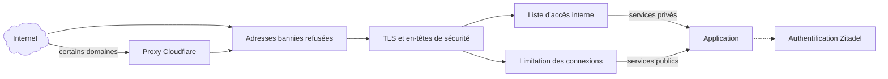

# 🔒 Sécurité

La sécurité repose sur plusieurs couches indépendantes : une requête doit franchir chacune d’elles avant d’atteindre un service, et aucune ne suffit seule. Cette page décrit leur conception ; les travaux en cours sont listés dans la [feuille de route](feuille-de-route.md).

## ☁️ Proxy Cloudflare {#cloudflare}

Les sites `minitrainstore.fr` et `guenola-sahut.fr` passent par le proxy de Cloudflare, qui absorbe une partie du trafic indésirable avant qu’il n’atteigne Bruxelles. Pour que ce filtre ne puisse pas être contourné, Traefik refuse sur ces sites toute connexion qui ne vient pas des plages d’adresses publiées par Cloudflare. Les autres domaines pointent directement vers les serveurs.

## 🚪 Points d’entrée Traefik {#traefik}

Chaque hôte a un seul point d’entrée web, Traefik. Les protections communes sont attachées au point d’entrée HTTPS lui-même, et non route par route : un nouveau service les reçoit sans configuration, qu’il soit déclaré par étiquettes Docker ou dans les fichiers de routes.

- **HTTPS partout :** HTTP redirige vers HTTPS. TLS 1.2 au minimum, avec uniquement des suites à échange de clés éphémère (ECDHE) et chiffrement authentifié (AES-GCM, ChaCha20). Un nom inconnu ne reçoit aucun certificat par défaut.
- **En-têtes de sécurité :** HSTS sur chaque site HTTPS, et interdiction de deviner le type des contenus (`nosniff`). HSTS n’est pas étendu aux sous-domaines : il forcerait HTTPS sur des appareils du réseau local qui ne parlent que HTTP.
- **En-têtes falsifiés :** les variantes d’en-têtes de transfert écrites avec des tirets bas sont supprimées, pour qu’un client ne puisse pas se faire passer pour une autre adresse.

### 🧱 CrowdSec {#crowdsec}

[CrowdSec](https://www.crowdsec.net/) lit le journal d’accès de Traefik, détecte les comportements hostiles (balayages, tentatives de connexion en force, recherche de vulnérabilités connues) et bannit les adresses en cause. Il reçoit aussi la liste de blocage communautaire de CrowdSec. Un module de Traefik (_bouncer_) consulte ces décisions et refuse les adresses bannies avant toute autre étape, sur toutes les routes, internes comprises.

- Le LAN et le VPN ne sont jamais bannis : ils sont exclus des décisions de CrowdSec, et le module les laisse toujours passer.
- Derrière Cloudflare, c’est l’adresse réelle du visiteur qui est vérifiée, pas celle de Cloudflare.
- L’API de CrowdSec n’est joignable que par Traefik, sur un réseau Docker réservé ; CrowdSec lit les journaux par une vue en lecture seule de l’API Docker, limitée à la liste des conteneurs et à leurs journaux.

CrowdSec est fusionné dans le dépôt pour Luxembourg et en cours de déploiement ; Bruxelles suivra.

### 🏠 Services internes {#services-internes}

Les services privés n’acceptent que les connexions venant du LAN ou du VPN NetBird, grâce à une liste d’accès appliquée par Traefik. Elle vérifie l’adresse de la connexion elle-même, et non les en-têtes transmis : faire confiance aux en-têtes de Cloudflare, pour transmettre l’adresse du visiteur aux applications, ne l’élargit pas. Leur nom DNS pointe en plus vers une adresse du réseau local. Les outils d’administration en font partie : consoles des serveurs et des conteneurs, tableau de bord de Traefik, supervision, déploiement, coffre de signature de Xila.

### ⏱️ Limitation des connexions {#limitation}

Sur les services publics, les formulaires de connexion sont limités par adresse cliente : au-delà d’un certain nombre de tentatives, Traefik répond `429 Too Many Requests`. Seuls les envois de formulaires de connexion sont comptés, si bien que la synchronisation des applications (Nextcloud, Jellyfin, Home Assistant, Bitwarden…) n’est pas ralentie ; les limites propres à chaque application s’ajoutent à celle-ci. Sont concernés : Zitadel, Vaultwarden, Nextcloud, Jellyfin, Home Assistant, Tolgee et NetBird. Cette limitation est fusionnée dans le dépôt et en cours de déploiement.

## 🪪 Authentification unique {#authentification}

[Zitadel](https://zitadel.com/) centralise l’identité des utilisateurs. Les services raccordés délèguent la connexion à Zitadel en OpenID Connect, avec PKCE par défaut, et les droits dans chaque service découlent des rôles attribués dans Zitadel. Les applications OIDC sont déclarées dans le dépôt et créées par OpenTofu (voir [Architecture](architecture.md#authentification)).

## 🔑 Accès SSH {#ssh}

- **Compte d’automatisation dédié :** Ansible se connecte avec un compte réservé, distinct des comptes personnels, par clé SSH uniquement. Son mot de passe est verrouillé ; il dispose de `sudo` sans mot de passe pour les déploiements.
- **Clés restreintes :** chaque clé autorisée sur ce compte n’est acceptée que depuis les réseaux privés de l’infrastructure, et aucune autre clé n’est conservée. Le playbook qui le configure refuse de s’exécuter depuis une connexion qui ne viendrait pas de ces réseaux, pour ne jamais se couper l’accès.
- **`sshd` durci :** pas d’authentification par mot de passe, pas de connexion `root`, et seuls le compte d’automatisation et une courte liste de comptes nommés peuvent se connecter.
- **Un compte par usage :** les machines qui doivent se joindre ont leur propre compte et leur propre clé, jamais le compte d’automatisation. Par exemple, pour la réplication, chaque client ne peut lancer, par une commande forcée, que sa propre tâche de réplication sur Bruxelles ; la clé d’API de TrueNAS ne quitte jamais Bruxelles.
- **TrueNAS :** ses utilisateurs et son serveur SSH se règlent dans son interface. Ansible n’y change rien mais vérifie les réglages (clés et restrictions, connexion par mot de passe désactivée) et indique les corrections à faire.

## 🗝️ Secrets {#secrets}

- Les secrets sont chiffrés avec Ansible Vault dans un sous-module privé ; le mot de passe du coffre reste dans le trousseau du système (voir [Déploiement](deploiement.md#secrets)).
- Sur les serveurs, ils ne sont écrits que dans le fichier `.env` du service concerné, lisible par son seul propriétaire, et jamais affichés dans les journaux de déploiement.
- L’état d’OpenTofu, qui contient les identifiants des applications Zitadel, est chiffré ; OpenTofu refuse de l’écrire en clair.
- L’intégration continue n’a aucun secret : elle travaille sur des fichiers de coffre vides.

## 🧩 Cloisonnement des réseaux {#cloisonnement}

- **Bases de données :** les bases des services déployés par Ansible sont sur des réseaux Docker internes, sans route vers Internet ; celles que l’outil de sauvegarde des bases doit joindre partagent en plus un réseau avec lui. Un réseau par base de données, pour que les bases ne se voient plus entre elles, est prévu.
- **Réseaux réservés :** CrowdSec et Traefik partagent un réseau qui leur est propre ; la supervision lit les métriques de Traefik sur un point d’entrée qui n’est jamais publié.
- **Ports publiés :** Docker publie les ports en contournant le pare-feu de l’hôte. Seul Traefik publie les ports web ; tout autre service passe par lui.
- **Réseaux proxy par application** _(prévu)_ : chaque application aura son propre petit réseau partagé uniquement avec Traefik, pour qu’une application compromise ne puisse pas joindre les autres. Le plan d’adressage est décrit dans la page [Réseau](reseau.md#isolation-des-applications).
- **Conteneurs :** Traefik et CrowdSec tournent sans possibilité d’élévation de privilèges (`no-new-privileges`), et les journaux de tous les conteneurs sont plafonnés pour ne pas remplir les disques.

## 🔄 Mises à jour {#mises-a-jour}

Toutes les images sont figées sur une version exacte et mises à jour chaque semaine par Dependabot, après vérification par l’intégration continue (voir [Déploiement](deploiement.md#mises-a-jour)). Les paquets de Luxembourg et de Pristina sont mis à jour par des playbooks dédiés.
