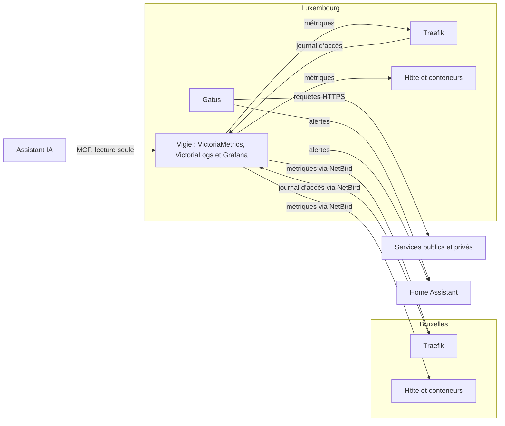

# 📈 Supervision

Deux outils complémentaires surveillent l’infrastructure : **Gatus** vérifie de l’extérieur que chaque service répond, **Vigie** mesure de l’intérieur le trafic qui passe par Traefik, l’état des serveurs et de leurs conteneurs, et garde le journal de chaque requête. Tous deux tournent sur Luxembourg, hors du site principal : une coupure de Bruxelles reste visible et signalée.



## 💚 Gatus {#gatus}

[Gatus](https://gatus.io/) publie l’état des services sur [etat.anneraud.fr](https://etat.anneraud.fr/) ; la page [État des services](/etat) de ce site en reprend les badges.

- **Services :** chaque service est interrogé toutes les 10 minutes. Le code de réponse doit être `200` et, quand le service expose un point de santé, le contenu de la réponse est vérifié aussi (base de données joignable, état « OK »…).
- **Certificats :** chaque vérification exige un certificat TLS valable encore au moins deux semaines. Un renouvellement automatique qui échoue est ainsi signalé bien avant l’expiration.
- **Hôtes :** Bruxelles et Luxembourg sont testés chaque minute par ping (ICMP).
- **Groupes :** services, administration (outils internes) et infrastructure (hôtes). Les outils internes de Luxembourg sont vérifiés directement depuis le réseau Docker, puisque la liste d’accès interne de Traefik n’accepte que le réseau local et le VPN.
- **Alertes :** Gatus prévient Home Assistant dès le premier échec, puis à nouveau quand le service est rétabli.

L’historique est conservé dans une base PostgreSQL, sur un réseau Docker interne. Une seconde instance, avec la même configuration de base, sert la page d’état du domaine distinct `dera.page`.

## 🔭 Vigie {#vigie}

Vigie réunit [VictoriaMetrics](https://victoriametrics.com/), qui collecte et stocke les métriques, [VictoriaLogs](https://docs.victoriametrics.com/victorialogs/), qui garde les journaux, et [Grafana](https://grafana.com/), qui les affiche et déclenche les alertes. Elle est privée : accessible uniquement depuis le réseau local ou le VPN. Rien de ce qu’elle lit n’est publié : sur Luxembourg, tout passe par des réseaux Docker internes ; Bruxelles répond par le VPN NetBird, derrière la liste d’accès interne de son Traefik.

- **Traefik :** les métriques des deux instances (requêtes, codes de réponse, durées, par service et par hôte), lues sur un point d’entrée jamais publié.
- **Serveurs et conteneurs :** [node_exporter](https://github.com/prometheus/node_exporter) mesure le processeur, la mémoire, la charge, les systèmes de fichiers, le cache ZFS et l’état de chaque pool ; [cAdvisor](https://github.com/google/cadvisor) mesure le processeur et la mémoire de chaque conteneur, regroupés par application. Les deux tournent en lecture seule, sans privilège.
- **CrowdSec :** alertes, bannissements, lignes de journal lues, requêtes du module de Traefik, une collecte par hôte (voir [Sécurité](securite.md#crowdsec)). Sur Luxembourg, par un réseau réservé à CrowdSec et à Vigie ; sur Bruxelles, par son Traefik derrière la liste d’accès interne, qui ne transmet que `/metrics` et joint CrowdSec par son réseau réservé, sans le mettre sur le réseau proxy.
- **Journaux d’accès :** [Vector](https://vector.dev/), sur chaque hôte, lit la sortie du conteneur Traefik par une vue en lecture seule de l’API Docker et l’envoie à VictoriaLogs : un enregistrement par requête, avec l’adresse du client, le domaine, le chemin, le code et la taille de la réponse, le routeur, l’agent utilisateur et la durée. Bruxelles l’envoie par le VPN à une seule adresse d’écriture de Vigie, derrière sa liste d’accès interne.
- **Conservation :** une mesure toutes les 30 secondes, gardée trois mois ; les journaux d’accès, 14 jours (2 Gio au plus).
- **Tableaux de bord**, provisionnés depuis le dépôt : Traefik, journaux Traefik (filtrés par hôte, client, domaine et code de réponse), hôtes (processeur, mémoire, espace des pools ZFS, consommation de chaque application), CrowdSec et limitation des connexions.

### 🚨 Alertes {#alertes}

Les règles d’alerte sont décrites dans le dépôt et évaluées en continu. Une alerte ne part que si la situation dure plusieurs minutes, et seulement pour des services qui reçoivent assez de requêtes pour que la mesure ait un sens.

| Alerte               | Déclenchement                                                                                                                                                                          |
| -------------------- | -------------------------------------------------------------------------------------------------------------------------------------------------------------------------------------- |
| Erreurs serveur      | Une part notable des réponses d’un service sont des erreurs `5xx`                                                                                                                      |
| Réponses lentes      | Les réponses les plus lentes d’un service dépassent un seuil ; les services qui gardent volontairement des connexions longues (flux, envois, synchronisation Matrix, VPN…) sont exclus |
| Métriques manquantes | Une instance de Traefik ou un hôte ne peut plus être interrogé, ou plus aucune métrique n’arrive                                                                                       |
| Disque presque plein | Un système de fichiers (hors ZFS) est plein à plus de 90 %                                                                                                                             |
| Pool ZFS dégradé     | Un pool ZFS n’est plus dans l’état `ONLINE`                                                                                                                                            |
| Mémoire, processeur  | La mémoire d’un hôte est utilisée à plus de 90 % pendant 15 minutes, ou son processeur pendant 30 minutes                                                                              |
| CrowdSec             | CrowdSec ne répond plus, le module de Traefik ne lui demande plus ses décisions, il ne lit plus aucun journal, ou ses alertes dépassent nettement le bruit de fond d’Internet          |
| Connexions limitées  | Un formulaire de connexion refuse beaucoup de tentatives en peu de temps                                                                                                               |
| Sauvegardes          | La sauvegarde vers Google Drive échoue, ou sa dernière réussite date de plus de 36 heures (voir [Sauvegardes](sauvegardes.md#google-drive))                                            |

Le remplissage des pools ZFS, les disques défaillants et les vérifications des pools restent signalés par TrueNAS lui-même.

Les alertes sont envoyées à Home Assistant par un webhook, regroupées par alerte, service et hôte, et rappelées périodiquement tant qu’elles durent. L’intégration continue démarre Vigie avec des métriques et des journaux d’exemple : chaque règle doit se déclencher, ou non, comme prévu, chaque requête des tableaux de bord doit être valide, et les journaux doivent se relire avec leurs champs.

### 🤖 Assistant {#assistant}

Vigie fait aussi tourner le serveur [MCP](https://modelcontextprotocol.io/) officiel de Grafana. Branché sur [MCPHub](https://github.com/samanhappy/mcphub), il permet à un assistant IA d’interroger les métriques et les journaux d’accès, de lire les tableaux de bord et l’état des alertes, par exemple pour retrouver d’où viennent des requêtes suspectes. Il est en lecture seule, lit Grafana avec un compte de service limité à la consultation, et refuse toute requête sans son propre jeton.

### 🔎 Interroger les journaux {#journaux}

Le tableau de bord des journaux Traefik filtre par hôte, adresse cliente, domaine et code de réponse. Pour aller plus loin, **Explore → VictoriaLogs** accepte toute requête [LogsQL](https://docs.victoriametrics.com/victorialogs/logsql/), par exemple :

```
ClientHost:="203.0.113.7" DownstreamStatus:=200 | fields _time, RequestHost, RequestPath, DownstreamContentSize, RouterName, request_User-Agent
RequestHost:="simrepo.dera.page" DownstreamStatus:>=400 | stats by (DownstreamStatus) count()
```

Un [assistant IA](assistants.md#grafana) pose les mêmes requêtes par le serveur MCP de Grafana.

### 🧰 Exploitation {#exploitation}

- **Coffre :** `vault/vigie/vault.yml` contient `vigie_grafana_admin_password` et `vigie_home_assistant_webhook_id`. Le mot de passe administrateur ne sert qu’au premier démarrage de Grafana ; pour le changer ensuite, `docker exec -it vigie-grafana-1 grafana cli admin reset-admin-password <mot de passe>` sur Luxembourg, puis mettre à jour le coffre.
- **Home Assistant :** une automatisation à déclencheur webhook, d’identifiant `vigie_home_assistant_webhook_id`, avec `local_only: false` : Grafana l’appelle par `maison.anneraud.fr` depuis Luxembourg.
- **Déploiement :** `mise deploy services/vigie/deploy.yml`, avec mise, puisqu’il provisionne aussi l’application Zitadel de Grafana. Il télécharge l’extension VictoriaLogs de Grafana, vérifiée par sa somme de contrôle.
- **Nouvel hôte :** déployer <RepositoryReference path="services/metriques" /> sur l’hôte (collecteurs et Vector), puis Vigie, qui ajoute ses cibles. Un hôte distant expose ses collecteurs par son Traefik (`metriques_host` dans ses variables) ; son déploiement envoie un lot vide à Vigie et s’arrête en expliquant un refus (`403` : adresse hors de la liste d’accès de Luxembourg ; pas de réponse : Luxembourg injoignable par le VPN).
- **Pools ZFS :** leur remplissage, les disques défaillants et les vérifications restent signalés par TrueNAS : garder un service d’alerte configuré dans **TrueNAS → System → Alert Settings**.
- **Réglages :** durées de conservation des journaux dans <RepositoryReference path="inventory/group_vars/vigie.yml" />, cibles dans <RepositoryReference path="services/vigie/scrape.yml.j2" />, règles d’alerte et tableaux de bord dans <RepositoryReference path="services/vigie/grafana" />.

### 🪪 Connexion {#connexion}

La connexion à Grafana passe par [Zitadel](architecture.md#authentification). Les membres du rôle `vigie-admin` sont administrateurs, les autres ont un accès en lecture. Se déconnecter de Grafana ferme aussi la session Zitadel.
