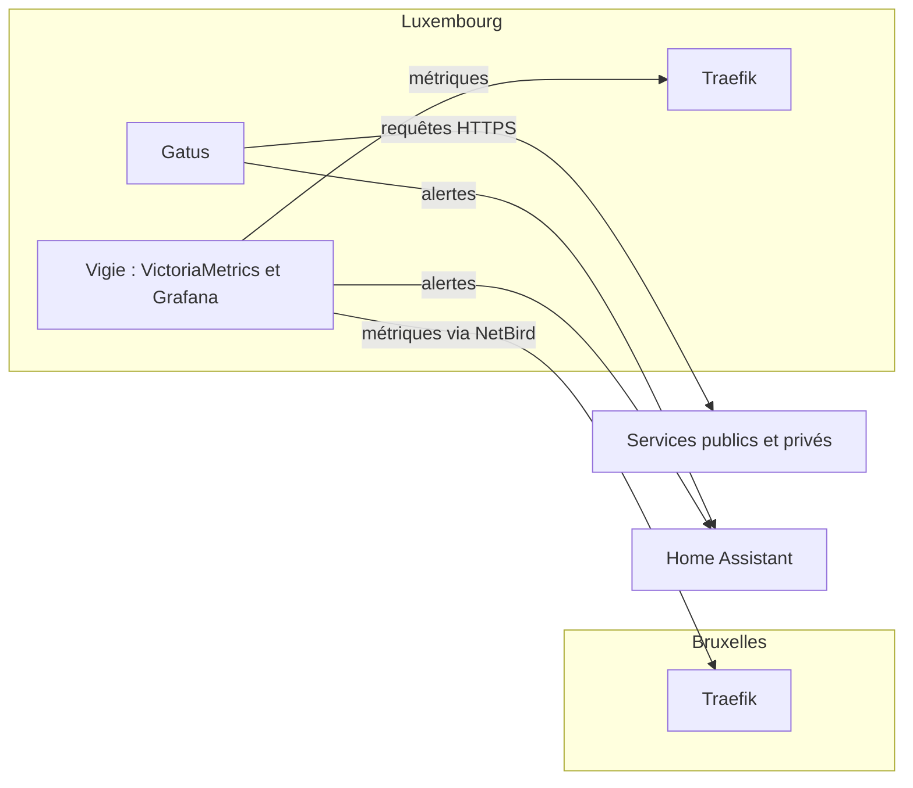

# 📈 Supervision

Deux outils complémentaires surveillent l’infrastructure : **Gatus** vérifie de l’extérieur que chaque service répond, **Vigie** mesure de l’intérieur le trafic qui passe par Traefik. Tous deux tournent sur Luxembourg, hors du site principal : une coupure de Bruxelles reste visible et signalée.

## 💚 Gatus {#gatus}

[Gatus](https://gatus.io/) publie l’état des services sur [etat.anneraud.fr](https://etat.anneraud.fr/) ; la page [État des services](/etat) de ce site en reprend les badges.

- **Services :** chaque service est interrogé toutes les 10 minutes. Le code de réponse doit être `200` et, quand le service expose un point de santé, le contenu de la réponse est vérifié aussi (base de données joignable, état « OK »…).
- **Certificats :** chaque vérification exige un certificat TLS valable encore au moins deux semaines. Un renouvellement automatique qui échoue est ainsi signalé bien avant l’expiration.
- **Hôtes :** Bruxelles et Luxembourg sont testés par ping chaque minute.
- **Groupes :** services, administration (outils internes) et infrastructure (hôtes). Les outils internes de Luxembourg sont vérifiés directement depuis le réseau Docker, puisque la liste d’accès interne de Traefik n’accepte que le LAN et le VPN.
- **Alertes :** Gatus prévient Home Assistant dès le premier échec, puis à nouveau quand le service est rétabli. Home Assistant relaie la notification.

L’historique est conservé dans une base PostgreSQL, sur un réseau Docker interne. Une seconde instance, avec la même configuration de base, sert la page d’état du domaine distinct `dera.page`.

## 🔭 Vigie {#vigie}

Vigie réunit [VictoriaMetrics](https://victoriametrics.com/), qui collecte et stocke les métriques, et [Grafana](https://grafana.com/), qui les affiche et déclenche les alertes. Elle n’est accessible que depuis le LAN ou le VPN.

- **Sources :** les métriques des deux instances de Traefik (requêtes, codes de réponse, durées, par service et par hôte). Celles de Luxembourg sont lues sur un point d’entrée réservé au réseau Docker, jamais publié ; celles de Bruxelles passent par le VPN NetBird et la liste d’accès interne de Bruxelles.
- **Conservation :** une mesure toutes les 30 secondes, gardée trois mois.
- **Tableau de bord :** un tableau Traefik provisionné depuis le dépôt.

### 🚨 Alertes {#alertes}

Les règles d’alerte sont décrites dans le dépôt et évaluées en continu. Une alerte ne part que si la situation dure plusieurs minutes, et seulement pour des services qui reçoivent assez de requêtes pour que la mesure ait un sens.

| Alerte               | Déclenchement                                                                                                                                                                          |
| -------------------- | -------------------------------------------------------------------------------------------------------------------------------------------------------------------------------------- |
| Erreurs serveur      | Une part notable des réponses d’un service sont des erreurs `5xx`                                                                                                                      |
| Réponses lentes      | Les réponses les plus lentes d’un service dépassent un seuil ; les services qui gardent volontairement des connexions longues (flux, envois, synchronisation Matrix, VPN…) sont exclus |
| Métriques manquantes | Une instance de Traefik ne peut plus être interrogée, ou plus aucune métrique n’arrive                                                                                                 |

Les alertes sont envoyées à Home Assistant par un webhook, regroupées par alerte, service et hôte, et rappelées périodiquement tant qu’elles durent. L’intégration continue démarre Vigie avec des métriques d’exemple et vérifie que chaque règle se déclenche, ou non, comme prévu.

### 🪪 Connexion {#connexion}

La connexion à Grafana passe par [Zitadel](architecture.md#authentification). Les membres du rôle `vigie-admin` sont administrateurs, les autres ont un accès en lecture. Se déconnecter de Grafana ferme aussi la session Zitadel.
