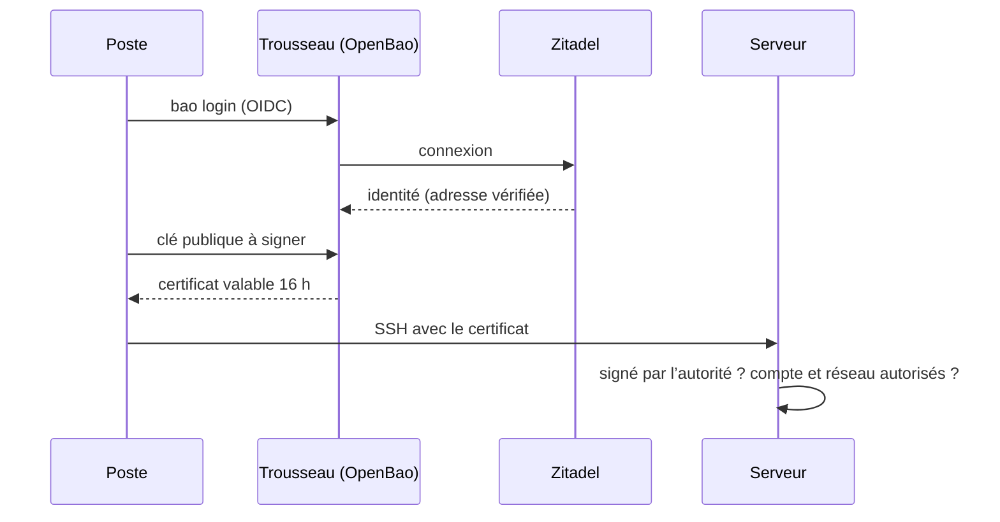

# 🔑 Trousseau

Trousseau délivre les certificats SSH : au lieu de copier la clé publique de chaque poste sur chaque serveur, les serveurs font confiance à une autorité de certification, et chaque poste obtient pour sa clé un certificat valable une journée de travail, après une connexion par [Zitadel](authentification.md). C’est une instance [OpenBao](https://openbao.org/) (<RepositoryReference path="services/trousseau" />), distincte de celle qui signe les versions de Xila.

## 🧭 Principe {#principe}

- **Deux autorités, dont les clés privées ne quittent jamais OpenBao :** `ssh-utilisateurs` signe les clés avec lesquelles on se connecte, `ssh-hotes` celles des serveurs, pour qu’un poste les reconnaisse sans demander de confirmation.
- **Un certificat par compte :** le rôle `alix` signe pour le compte `alix_anneraud` seulement, le rôle `ansible` pour le compte `ansible` seulement, et son certificat n’est accepté que depuis le réseau local et le VPN (`source-address`), comme ses clés aujourd’hui.
- **Une journée :** les certificats des utilisateurs durent 16 heures. Un poste perdu n’a plus d’accès le lendemain, sans révocation à gérer ; les certificats des serveurs durent deux ans.
- **Derrière le VPN :** OpenBao n’est joignable que par la liste d’accès interne de Traefik, sur Luxembourg ; SSH lui-même n’accepte de toute façon que ces réseaux. Son interface web est sur [trousseau.anneraud.fr/ui](https://trousseau.anneraud.fr/ui).

## 🧾 Ce que décrit le dépôt {#perimetre}

- **Le serveur** (<RepositoryReference path="services/trousseau" />) : stockage raft sur Luxembourg, déverrouillage automatique par une clé statique du coffre, journal d’audit dans la sortie du conteneur.
- **Le premier démarrage** (bloc `initialize` de `config.hcl.j2`) : OpenBao s’initialise seul et crée le rôle AppRole `deploiement`, avec la politique `administration` et le secret du coffre. Son jeton root est révoqué aussitôt : aucun jeton permanent n’existe.
- **Tout le reste** (<RepositoryReference path="opentofu/trousseau" />), appliqué par OpenTofu avec cet AppRole à chaque déploiement : les politiques, la connexion par Zitadel, les deux autorités et leurs rôles. L’état est chiffré dans le coffre (`vault/trousseau/opentofu.tfstate`).
- **L’application Zitadel** `trousseau`, dans <RepositoryReference path="opentofu/zitadel/applications.auto.tfvars" /> : l’interface web et la ligne de commande reviennent toutes deux à l’adresse d’OpenBao.

OpenBao ne sait pas lire les rôles de Zitadel (un dictionnaire) : l’administrateur est le compte Zitadel dont l’adresse est `trousseau_administrator_email`, qu’OpenBao lit sur le point _userinfo_ de Zitadel.

## 🗝️ Secrets {#secrets}

Le coffre `vault/trousseau/vault.yml` contient :

| Clé                              | Rôle                                                                                                                                                    |
| -------------------------------- | ------------------------------------------------------------------------------------------------------------------------------------------------------- |
| `trousseau_seal_key`             | Clé de déverrouillage (`openssl rand -hex 32`). **Sans elle, les données d’OpenBao sont illisibles** : en garder une copie hors du coffre (Vaultwarden) |
| `trousseau_automation_secret_id` | Secret de l’AppRole `deploiement` (`openssl rand -hex 32`), lu au premier démarrage                                                                     |
| `trousseau_state_passphrase`     | Phrase de passe de l’état d’OpenTofu (`openssl rand -base64 32`)                                                                                        |
| `trousseau_administrator_email`  | Adresse Zitadel autorisée à administrer OpenBao                                                                                                         |

## 🚀 Mise en place {#mise-en-place}

1. **Coffre :** `mise vault:create vault/trousseau/vault.yml` avec les quatre clés ci-dessus, puis valider le dépôt des secrets et mettre à jour le sous-module.
2. **Déploiement**, depuis un poste sur le VPN : `mise deploy services/trousseau/deploy.yml`. Il crée l’application Zitadel, démarre OpenBao (qui s’initialise), applique OpenTofu et affiche les clés publiques des deux autorités. Valider ensuite l’état d’OpenTofu dans le dépôt des secrets.
3. **Gatus** surveille son point de santé (`mise deploy services/etat/deploy.yml`) : il ne répond `200` qu’une fois OpenBao déverrouillé.

Les serveurs ne font pas encore confiance aux autorités : les clés actuelles restent en place, et la bascule se fera hôte par hôte.

## 🧰 Exploitation {#exploitation}

- **Obtenir ses certificats :** `mise ssh:login` ouvre Zitadel dans le navigateur (OpenBao affiche ensuite une page de confirmation), signe `~/.ssh/id_ed25519` pour le compte `alix_anneraud` et, s’il existe, `~/.ssh/ansible` pour le compte `ansible`. `ssh` trouve tout seul le certificat (`…-cert.pub`) à côté de la clé. Une autre clé : `SSH_KEY=~/.ssh/autre mise ssh:login`.
- **Ligne de commande :** `bao` est installé par mise et `BAO_ADDR` défini dans <RepositoryReference path="mise.toml" /> ; `bao login -method=oidc callbackmode=direct` donne un jeton d’une heure.
- **Redémarrage :** OpenBao se déverrouille seul avec la clé statique ; Gatus alerte s’il reste verrouillé.
- **Changer la clé de déverrouillage :** OpenBao doit connaître l’ancienne et la nouvelle (`previous_key` du bloc `seal "static"`) le temps de rechiffrer : à faire en suivant la [documentation d’OpenBao](https://openbao.org/docs/configuration/seal/static/), jamais en remplaçant simplement la clé du coffre.
- **Haute disponibilité :** un seul nœud. Raft en demande trois sur trois sites distincts pour survivre à une panne : Bruxelles et Pristina partagent le même site, ce qui ne protégerait pas d’une coupure de la maison. Une panne d’OpenBao n’empêche pas d’utiliser les certificats déjà délivrés.

## ✅ Intégration continue {#ci}

<RepositoryReference path=".github/scripts/check-trousseau.sh" /> démarre OpenBao comme le déploiement : le premier démarrage doit l’initialiser et la clé statique le déverrouiller. Il applique OpenTofu deux fois (la seconde sans rien à changer), signe des clés, puis se connecte à un serveur SSH qui fait confiance à l’autorité et présente un certificat d’hôte : le certificat d’`alix_anneraud` n’ouvre que ce compte, une clé sans certificat est refusée et le certificat d’`ansible` ne fonctionne pas hors de ses réseaux. Un redémarrage doit le déverrouiller de nouveau, autorités intactes. La connexion par Zitadel n’y est pas testée, faute de Zitadel.
